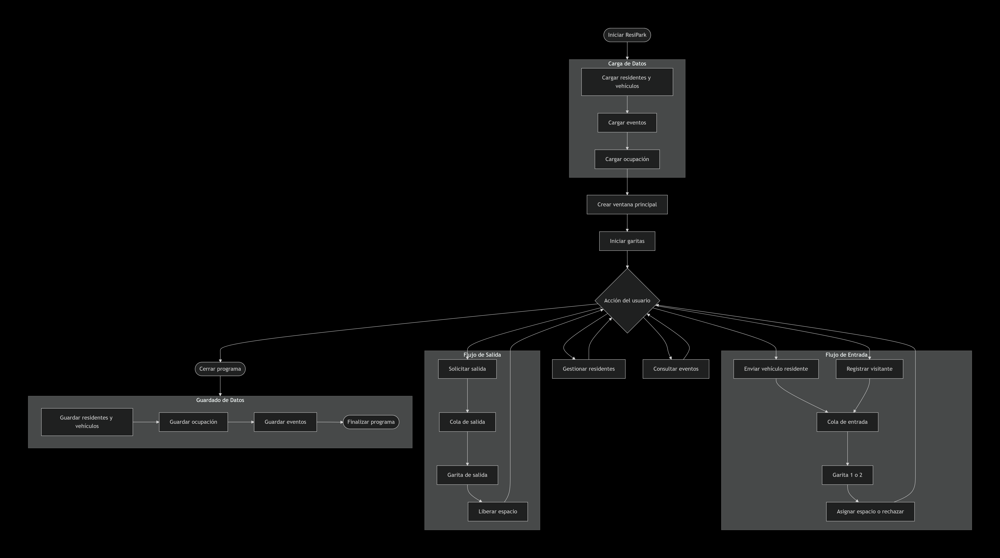
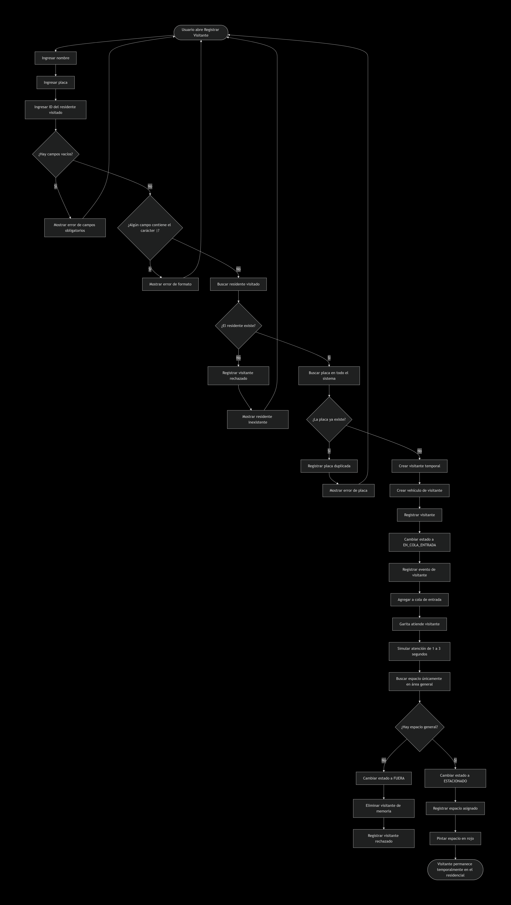
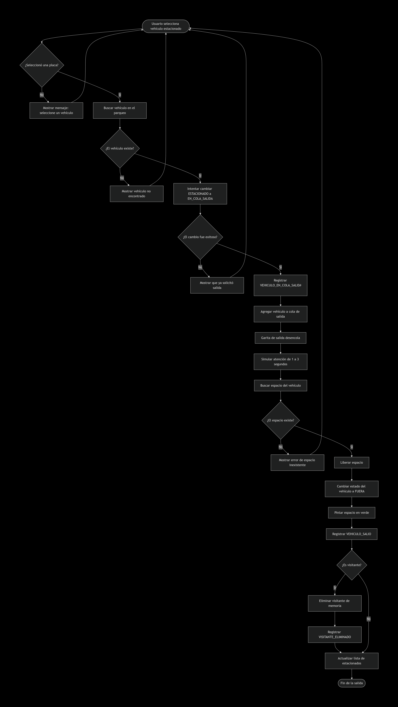
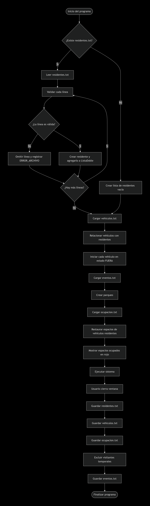
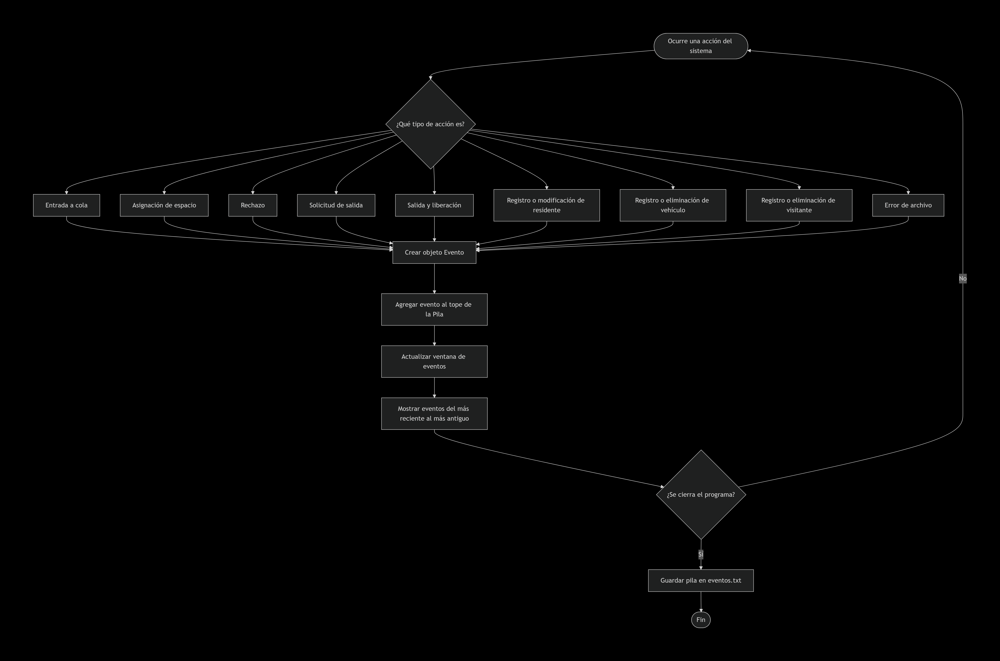

### FLUJO PRINCIPAL:

### Flujo de entrada de un vehículo residente

### Flujo de registro e ingreso de un visitante

### Flujo de solicitud y salida de un vehículo

### Flujo de persistencia al iniciar y cerrar

### Flujo de gestión de residentes y vehículos

### Flujo de eventos

