# Manual de usuario de ResiPark

## 1. Introducción

ResiPark es un sistema para controlar el ingreso, permanencia y salida de vehículos dentro de un residencial.

El sistema permite:

- Registrar residentes.
- Registrar vehículos.
- Registrar visitantes.
- Enviar vehículos a la cola de entrada.
- Asignar espacios de parqueo.
- Solicitar la salida de vehículos.
- Consultar las colas de entrada y salida.
- Consultar el historial de eventos.
- Guardar y recuperar información mediante archivos de texto.

---

## 2. Requisitos para ejecutar el sistema

Para utilizar ResiPark se necesita:

- Tener instalado Java JDK 17 o superior.
- Tener instalado Maven si se ejecuta desde el proyecto.
- Contar con el archivo `.jar` generado, si se ejecuta como aplicación independiente.
- Usar neatbeans o VS code para ejecutar o bien desde el .jar.

---

## 3. Ejecución del programa

### 3.1 Ejecución mediante archivo JAR

Después de generar el proyecto con:

ejecutar:

ResiPark-1.0-SNAPSHOT.jar


---

## 4. Ventana principal

Al iniciar el programa se muestra la ventana principal de ResiPark.

En esta ventana se encuentran:

- Campo para ingresar la placa de un vehículo.
- Botón para enviar un vehículo a la cola de entrada.
- Botón para enviar vehículos de prueba.
- Botón para gestionar residentes.
- Botón para registrar visitantes.
- Botón para consultar eventos.
- Cuadrícula del parqueo.
- Cola de entrada.
- Cola de salida.
- Estado de las garitas.
- Lista de vehículos estacionados.
- Botón para solicitar salida.

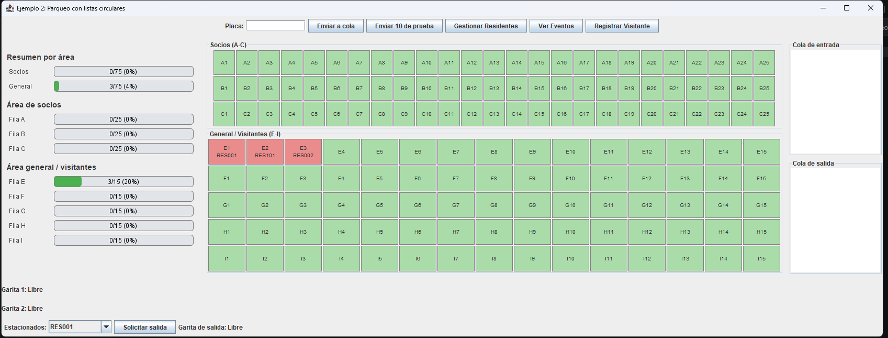

---

## 5. Interpretación de los colores del parqueo

Los espacios de la cuadrícula utilizan colores para indicar su estado:

- **Verde:** espacio libre.
- **Rojo:** espacio ocupado.

Cada espacio muestra su identificador. Cuando está ocupado, también muestra la placa del vehículo.

Ejemplo:

```text
E1
```

Indica que el espacio `E1` está libre.

```text
E1
RES001
```

Indica que el vehículo con placa `RES001` ocupa el espacio `E1`.


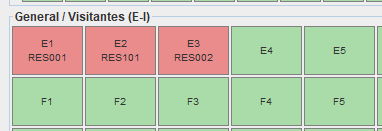

---

## 6. Distribución del estacionamiento

El parqueo está dividido en dos áreas.

### 6.1 Área de socios

Está formada por las filas:

```text
A, B y C
```

Cada fila tiene 25 espacios:

```text
A1-A25
B1-B25
C1-C25
```

Esta área contiene 75 espacios.

### 6.2 Área general y visitantes

Está formada por las filas:

```text
E, F, G, H e I
```

Cada fila tiene 15 espacios:

```text
E1-E15
F1-F15
G1-G15
H1-H15
I1-I15
```

Esta área contiene 75 espacios.

La fila `D` no existe.


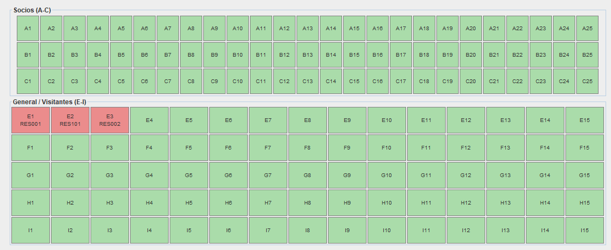

---

## 7. Registrar un residente

Para registrar un residente:

1. En la ventana principal, presionar el botón **Gestionar Residentes**.
2. Escribir el ID del residente.
3. Escribir el nombre.
4. Escribir la casa o lote.
5. Marcar la casilla si el residente es socio.
6. Presionar el botón **Registrar**.

Los campos obligatorios son:

- ID.
- Nombre.
- Casa o lote.

El ID debe ser único y no puede repetirse.

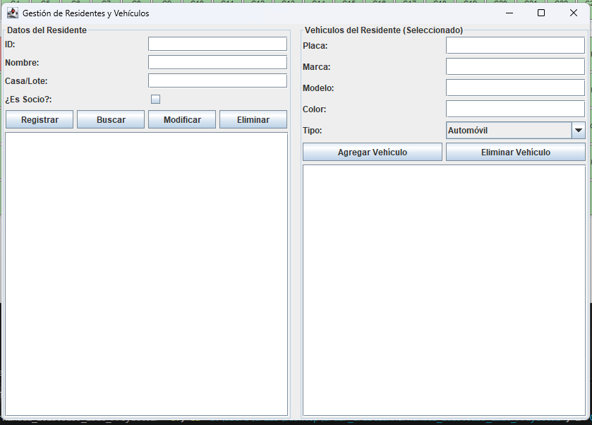

### Ejemplo

```text
ID: 202505139
Nombre: Cristian Hernandez
Casa/Lote: Casa 12
Es socio: Sí
```

Después de registrar el residente, este aparece en el área de residentes.


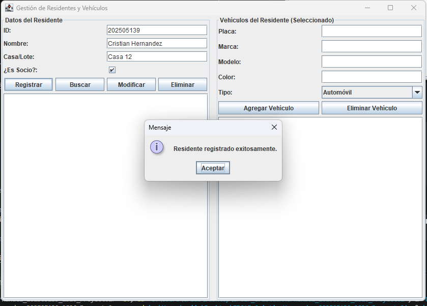

---

## 8. Buscar un residente

Para buscar un residente:

1. Abrir la ventana **Gestionar Residentes**.
2. Escribir el ID en el campo correspondiente.
3. Presionar el botón **Buscar**.

Si el residente existe, el sistema muestra:

- Nombre.
- Casa o lote.
- Condición de socio.
- Vehículos registrados.

Si no existe, se muestra un mensaje indicando que no fue encontrado.

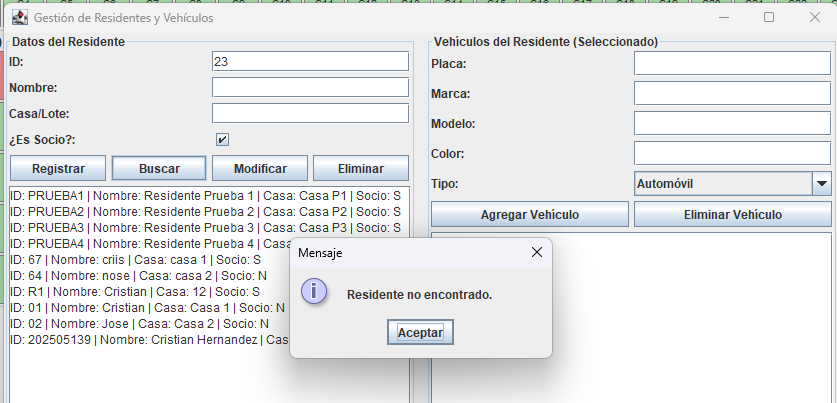

---

## 9. Modificar un residente

Para modificar un residente:

1. Buscar el residente mediante su ID.
2. Cambiar el nombre, la casa o la condición de socio.
3. Presionar el botón **Modificar**.

El ID se utiliza como identificador y no debe cambiarse.

No se permite cambiar la condición de socio si alguno de los vehículos del residente está dentro del residencial o en una cola.

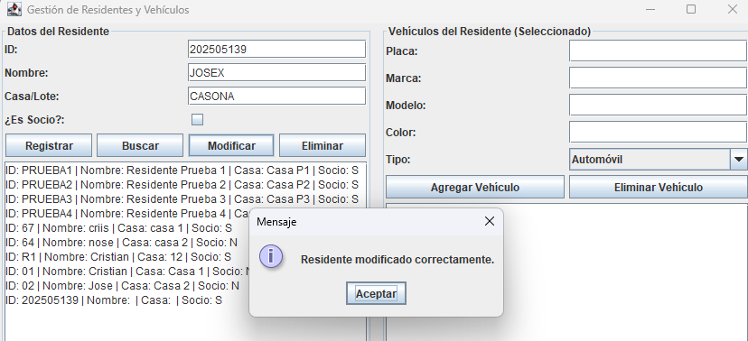

---

## 10. Eliminar un residente

Para eliminar un residente:

1. Escribir su ID.
2. Presionar el botón **Eliminar**.
3. Confirmar la operación si el sistema lo solicita.

Un residente solamente puede eliminarse cuando todos sus vehículos están en estado:

```text
FUERA
```

Si un vehículo está estacionado, en la cola de entrada o en la cola de salida, el sistema no permite eliminar al residente.

---

## 11. Registrar un vehículo

Para registrar un vehículo:

1. Abrir la ventana **Gestionar Residentes**.
2. Buscar o seleccionar un residente.
3. Escribir la placa.
4. Escribir la marca.
5. Escribir el modelo.
6. Escribir el color.
7. Seleccionar el tipo de vehículo.
8. Presionar **Agregar Vehículo**.

Los tipos disponibles pueden incluir:

- Automóvil.
- Motocicleta.
- Pickup.

Cada residente puede tener como máximo tres vehículos.


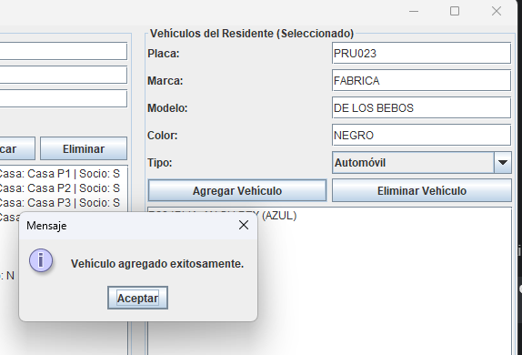

---

## 12. Eliminar un vehículo

Para eliminar un vehículo:

1. Buscar el residente al que pertenece.
2. Escribir la placa del vehículo.
3. Presionar **Eliminar Vehículo**.

El vehículo solamente puede eliminarse si está en estado:

```text
FUERA
```

No se puede eliminar un vehículo que esté:

- En la cola de entrada.
- Estacionado.
- En la cola de salida.

---

## 13. Ingresar un vehículo de residente

Para enviar un vehículo registrado a la cola de entrada:

1. Escribir la placa en el campo **Placa** de la ventana principal.
2. Presionar **Enviar a cola**.
3. El sistema valida que la placa pertenezca a un vehículo registrado.
4. El vehículo cambia a estado `EN_COLA_ENTRADA`.
5. Se agrega a la cola de entrada.
6. Una de las dos garitas atiende el vehículo.

El vehículo debe estar en estado:

```text
FUERA
```

Si ya está estacionado o en una cola, el sistema no permite enviarlo nuevamente.


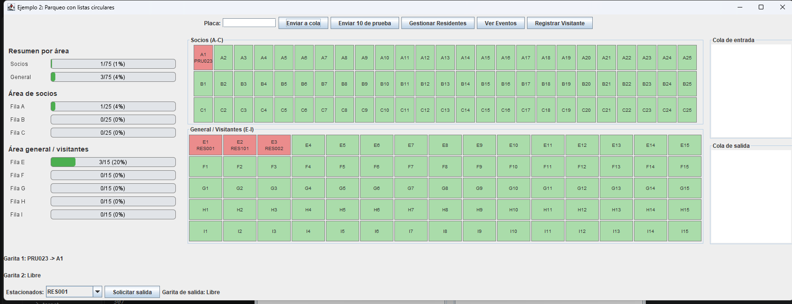

---

## 14. Asignación de espacios

Cuando una garita atiende un vehículo:

### Para residentes socios

El sistema busca primero en:
A, B y C

Si no encuentra espacio libre, busca en:
E, F, G, H e I

### Para residentes no socios

El sistema busca únicamente en:
E, F, G, H e I

Cuando se asigna un espacio:

- El vehículo cambia a estado ESTACIONADO.
- El espacio se pinta de rojo.
- La placa aparece dentro del espacio.
- Se registra un evento.
- El vehículo aparece en la lista de estacionados.
---

## 15. Registrar un visitante

Para registrar un visitante:

1. Presionar el botón **Registrar Visitante**.
2. Escribir el nombre del visitante.
3. Escribir la placa del vehículo.
4. Escribir el ID del residente visitado.
5. Presionar **Enviar a cola de entrada**.

El sistema valida que:

- El nombre no esté vacío.
- La placa no esté vacía.
- El ID del residente no esté vacío.
- El residente visitado exista.
- La placa no esté registrada previamente.

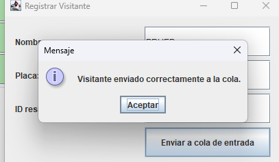

---

## 16. Estacionamiento de visitantes

Los visitantes solamente pueden ocupar espacios del área general:
E, F, G, H E I

Cuando el visitante se estaciona:

- Su espacio aparece en rojo.
- Su placa se muestra en la cuadrícula.
- Se registra el evento correspondiente.
- El visitante permanece temporalmente en memoria.

---

## 17. Visitante rechazado

Un visitante puede ser rechazado cuando no existe espacio disponible en el área general.

Cuando esto ocurre:

- Su estado vuelve a FUERA.
- Se elimina de la lista temporal de visitantes.
- No se guarda en los archivos permanentes.
- Se registra un evento de rechazo.
- El vehículo no permanece esperando en la cola.

---

## 18. Solicitar la salida de un vehículo

Para solicitar la salida:

1. Verificar que el vehículo aparezca en la lista **Estacionados**.
2. Seleccionar su placa.
3. Presionar **Solicitar salida**.
4. El vehículo cambia a estado EN_COLA_SALIDA.
5. Se agrega a la cola de salida.
6. Su espacio continúa ocupado mientras espera.

Un vehículo que ya solicitó salida no puede volver a solicitarla.

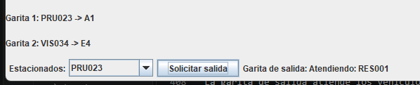

---

## 19. Consultar eventos

Para consultar los eventos:

1. Presionar el botón **Ver Eventos**.
2. Se abrirá la ventana del historial.
3. Los eventos se muestran del más reciente al más antiguo.

Entre los eventos registrados se encuentran:

- Vehículo enviado a la cola de entrada.
- Vehículo asignado.
- Vehículo rechazado.
- Visitante registrado.
- Visitante eliminado.
- Vehículo enviado a la cola de salida.
- Vehículo que salió.
- Residente registrado.
- Vehículo registrado.
- Errores de lectura de archivos.


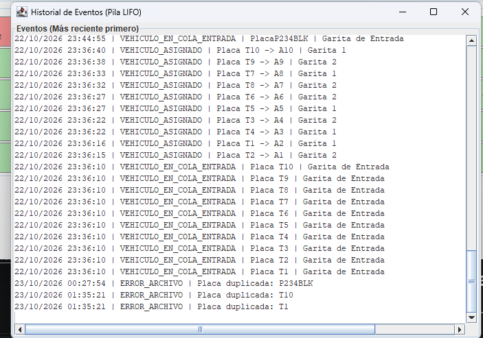

---
